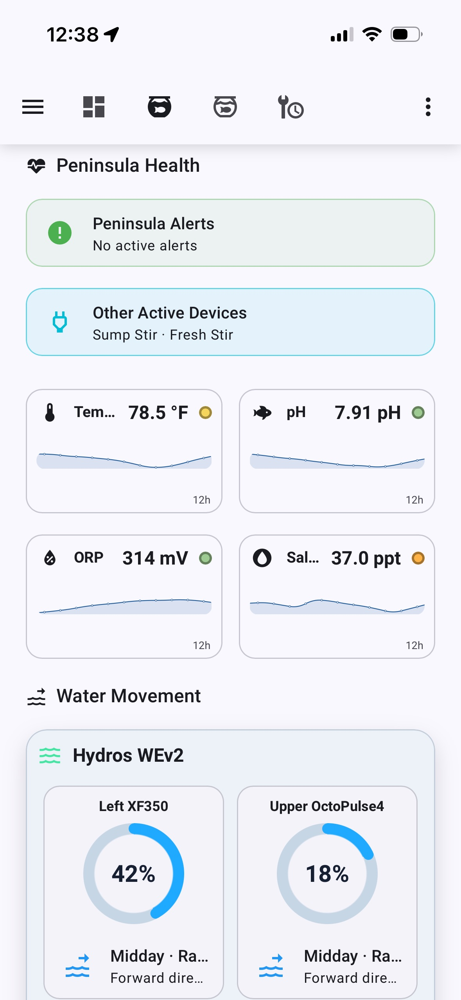

# Aquarium Automation Suite

Aquarium Automation Suite (AAS) is my Home Assistant dashboard and automation project for a Red Sea Peninsula reef aquarium and its HYDROS-controlled water-mixing station.

I have used Home Assistant since 2019. HYDROS and Red Sea each do a good job of
managing their own equipment, but I wanted one place to understand the display
aquarium, its supporting equipment, and the water-mixing station. AAS is that
common layer.

The dashboard is the product: helpers, templates, scripts, and automations exist to turn a large collection of devices and entities into a clear view of the aquarium system.

> [!NOTE]
> This repository documents a personal system and is shared as a reference for other aquarium and Home Assistant hobbyists. It is not a ready-to-install package, and local entity names and hardware will differ.

## The aquarium system

### Red Sea Peninsula 500 G2

The Peninsula is a mixed reef and the primary display aquarium in the main living area of our townhouse.

| Platform | Equipment |
| --- | --- |
| Hydros | Kraken, X4, Launch, WaveEngine v2, X2, and XS |
| Red Sea | ReefRun return pump, RSK-300 skimmer, ReefMat 500, ReefDose4 - 4-Part, and ReefDose4-Extra |
| Other | UV sterilizer, Avast Marine feeder, and ozone |

The Peninsula also uses automatic top off (ATO) and automatic water changes (AWC). Its Hydros collective includes the controllers at the mixing station.

The Hydros Simple Doser has been removed. Peninsula circulation is provided by
**Mid OctoPulse4**, **Upper OctoPulse4**, **Left XF350**, and a
**Sump OctoPulse 2**. The former Hydros Sump Stir output has been removed.

Both ReefDose controllers are assigned to the Home Assistant **Aquarium** area:

- **ReefDose4 - 4-Part** doses Red Sea Complete 4-Part.
- **ReefDose4-Extra** handles supplemental and occasional dosing.

Their entities use the prefixes `aquarium_reefdose4_4_part_*` and
`aquarium_reefdose4_extra_*`.

### Former Red Sea 200XL G2

The 200XL has been removed from the live AAS dashboards and is being handed off
with its own Home Assistant package. Reusable configuration remains under
[`handoff/`](handoff/); legacy snippets and screenshots are retained only as
historical reference. The former 200XL ReefDose now runs on the Peninsula as
`ReefDose4-Extra`.

### Mixing station

The mixing station is built around two nominal 30-gallon Brute reservoirs: one for RODI water and one for saltwater. Hydros X2, XS, and XD controllers manage the station. The XD drives three Kamoer dosing pumps used for ATO and AWC.

The mixing-station controllers belong to the same Hydros collective as the Peninsula. I also use the station for non-aquarium jobs, including watering plants, so controller runtime alone does not tell the whole inventory story. This is why water tracking became a major part of AAS.

Two TP-Link smart power strips provide additional switched outlets across the system.

## What Home Assistant adds

AAS brings the independent systems together in one interface:

- Two purpose-built Peninsula dashboards: Mobile and Tablet
- Water parameters and equipment state at a glance
- Home Assistant Auto / On / Off controls for selected HYDROS outputs
- RODI and saltwater reservoir estimates
- Guided water-removal and transfer workflows
- Aquarium maintenance controls organized around real tasks
- A foundation for activity history, usage statistics, and forecasting

The first major subsystem is the **Aquarium Water Management Suite (AWMS)**. It tracks water even when it leaves the mixing station for something other than an aquarium.

The Water Management **Used For** control is a Mushroom Select card bound directly to `input_select.awms_workflow`, so the selected workflow stays synchronized with the preview and workflow-specific controls.

After **Apply**, a frontend-local Browser Mod sequence runs the adjustment and
then displays a four-second acknowledgement directly on the browser that
submitted it. This approach does not require that browser to be registered with
Browser Mod.

### Dashboard experiences

AAS provides the same monitoring and maintenance model through two native Home
Assistant dashboards:

- **Aquarium Mobile** is optimized for portrait phones. It uses compact
  two-column cards and selective expanders for Testing, Dosing, and Filtration
  & Systems.
- **Aquarium Tablet** is optimized for a landscape iPad Pro. It uses the full
  width for a wide aquarium summary, larger equipment groups, and fewer
  collapsed sections.

Both dashboards use the views **Overview**, **Peninsula**, and **Maintenance**.
They share the same entities, templates, alert rules, status
colors, and AWMS workflow. Mobile keeps the Hydros Outputs controls in an
expander; Tablet presents them in a full-width cyan-bordered panel. Both expose
Auto / On / Off controls for Water Feed, Fresh Stir, Feed Stir, AWC ATO, AWC
Drain, AWC Fill, Avast Feed, and Display Fans, along with each output's running
or selected mode. ReefBeat and HYDROS remain useful for setup and advanced
configuration; Home Assistant now also controls these selected output modes.

See the [Mobile dashboard walkthrough](docs/mobile-dashboard.md) and
[Tablet dashboard walkthrough](docs/tablet-dashboard.md).

### Water parameter cards

Both aquarium dashboards use compact, theme-aware parameter cards with an icon,
current value, range bands, a status dot, and a history line. The cards use two
columns in the Mobile portrait layout and expand into wider groups on Tablet.
Main and testing grids use compact gaps between cards.

- **Peninsula:** Display Temperature, pH, ORP, and salinity are always visible
  with 12-hour graphs sampled at one point per hour.
- **Tank Health:** The Overview and Peninsula views can share the same
  color-banded Tank Health dial. It combines ReefControl level states with
  fresh manual chemistry tests and a nitrate/phosphate balance score. The
  compact and detailed card snippets live in
  `snippets/peninsula-tank-health-dial-cards.yaml`; the supporting sensors are
  in `snippets/peninsula-tank-health-template-sensors.yaml`. Aquarium Mobile
  uses the wave-pump-style ring card from
  `snippets/peninsula-tank-health-mobile-card.yaml` above Peninsula Alerts.

On the Peninsula equipment view, **Return 1200** and **Skimmer RSK300** share a
two-column **ReefRun** card. ReefMat and the remaining systems stay under
Filtration & Systems. The return ring is blue and the skimmer ring is purple,
matching ReefBeat. The skimmer box also reports whether sensor control is
active, restores the pump temperature on the same status line, and shows a red
**Over-skimming** warning from the ReefRun diagnostic state when needed.
- **Testing & Hydros Sensors:** A collapsed Mobile expander contains less
  frequently reviewed values; Tablet presents the same cards in a wide row.
  Salt Mix uses a 12-hour graph;
  manually entered weekly test results retain a 30-day window but show only
  five distinct samples: the current test and the previous four test periods.
  TDS remains a compact value-only card.

The Peninsula testing section includes Salt Mix, alkalinity, nitrate,
phosphate, calcium, magnesium, and TDS. Mini Graph Card surfaces are forced transparent
so the operating-range bands remain visible in the Home Assistant mobile app as
well as desktop browsers.

Weekly-test cards use concise chemistry labels: **Alkalinity dKH**,
**Nitrate NO₃**, **Phosphate PO₄**, **Calcium Ca**, and **Magnesium Mg**.

### Controller and equipment cards

The aquarium views use ReefBeat-inspired equipment cards while keeping
Hydros and Red Sea ownership clear:

- **Water Flow** presents the Hydros-controlled Peninsula wave pumps in the
  physical left-to-right order **Left XF350**, **Upper OctoPulse4**, and
  **Mid OctoPulse4**, together with the ReefRun return pump. The three dial
  cells use reduced padding, tighter gaps, and constrained 76px rings so the
  complete gauges remain visible on mobile.
- Hydros and ReefRun controller headings use reduced spacing above their inner
  equipment boxes for a more compact mobile layout.
- **Dosing** uses compact per-head rows with a daily progress bar, doses
  completed, current/target daily volume, remaining days, and four head
  indicators. The active indicator matches that head's dosing color.
- **ReefDose4 - 4-Part** and **ReefDose4-Extra** are stacked vertically.
  Remaining-days status is green at 15 days or more, yellow from 6–14 days,
  and red at 5 days or less.
- **Filtration & Systems** carries the same compact controller styling for the
  skimmer, ReefMat, feeder, sterilizer, ozone, and related equipment.

Mobile uses native Home Assistant views and selective expanders to keep long
sections manageable. Tablet uses the same cards in full-width rows. The three
Peninsula HYDROS circulation cards show live speed, the active schedule name,
and direction without duplicating schedule logic in dashboard YAML.

## Water inventory

Inventory is always stored internally in milliliters and converted to gallons for display.

```text
1 US gallon = 3,785.41 mL
```

| Reservoir | Working capacity | How it is used |
| --- | ---: | --- |
| Peninsula RODI | 111,700 mL / 29.5 gal | ATO, salt mixing, plants, and other uses |
| Peninsula saltwater | 111,700 mL / 29.5 gal | Automatic and manual water changes |

### Current workflows

| Workflow | Source | Inventory result |
| --- | --- | --- |
| Plants | Peninsula RODI | Decrease RODI |
| Make New Salt | Peninsula RODI | Decrease RODI and fill saltwater to capacity |
| Other | RODI or saltwater | Decrease the selected reservoir |

## Dashboard preview

| Aquarium Mobile | Aquarium Tablet |
| --- | --- |
|  | [View the current full-page Tablet capture](docs/assets/screenshots/tablet/tablet-peninsula-current.png) |

Mobile keeps the complete system usable in portrait orientation; Tablet uses
landscape width to show related monitoring groups together. The detailed
[Mobile](docs/mobile-dashboard.md) and [Tablet](docs/tablet-dashboard.md)
walkthroughs include Overview, Peninsula, dosing, systems, and maintenance.

## Repository guide

This repository contains reusable portions of the working configuration rather than a complete Home Assistant backup.

| File | Purpose |
| --- | --- |
| [`docs/index.md`](docs/index.md) | Public GitHub Pages project overview |
| [`docs/mobile-dashboard.md`](docs/mobile-dashboard.md) | Aquarium Mobile design and screenshot walkthrough |
| [`docs/tablet-dashboard.md`](docs/tablet-dashboard.md) | Aquarium Tablet design and screenshot walkthrough |
| [`docs/architecture.md`](docs/architecture.md) | System ownership, source-of-truth, and deterministic automation boundaries |
| [`docs/reefbeat-inventory.md`](docs/reefbeat-inventory.md) | Current Red Sea integration capabilities and maintenance ownership |
| [`skills/aquarium-management/SKILL.md`](skills/aquarium-management/SKILL.md) | Read-only Hermes v1 operating and diagnostic skill for the live Peninsula |
| [`docs/assets/Overview Screen for Aquarium Mobile.docx`](docs/assets/Overview%20Screen%20for%20Aquarium%20Mobile.docx) | Source walkthrough containing the supplied Mobile and Tablet captures |
| [`snippets/awms-water-management-stack.yaml`](snippets/awms-water-management-stack.yaml) | Main Water Management dashboard panel |
| [`snippets/awms-water-management-expander.yaml`](snippets/awms-water-management-expander.yaml) | Collapsible Water Management panel |
| [`snippets/awms-reservoir-gauge-cards.yaml`](snippets/awms-reservoir-gauge-cards.yaml) | Reservoir status gauges |
| [`snippets/awms-template-sensors.yaml`](snippets/awms-template-sensors.yaml) | AWMS display and calculation sensors |
| [`snippets/awms-apply-adjustment-full-script.yaml`](snippets/awms-apply-adjustment-full-script.yaml) | Script UI logic for inventory changes |
| [`snippets/awms-sync-workflow-defaults-automation.yaml`](snippets/awms-sync-workflow-defaults-automation.yaml) | Workflow-aware helper defaults |
| [`snippets/awms-recent-activity-card.yaml`](snippets/awms-recent-activity-card.yaml) | Optional recent activity card |
| [`snippets/peninsula-water-parameters-chips.yaml`](snippets/peninsula-water-parameters-chips.yaml) | Current Peninsula parameter, water-level, and additional-parameter card stack |
| [`handoff/`](handoff/) | Decommissioned 200XL package for its receiving Home Assistant installation |
| [`snippets/peninsula-controller-equipment.yaml`](snippets/peninsula-controller-equipment.yaml) | Peninsula Water Flow, Dosing, and Filtration & Systems expanders |
| [`snippets/aquarium-controller-tabs-style.yaml`](snippets/aquarium-controller-tabs-style.yaml) | Legacy Simple Tabs styling retained for reference |
| [`snippets/aquarium-youtube-video-card.yaml`](snippets/aquarium-youtube-video-card.yaml) | Embedded 16:9 YouTube player card for the Aquarium dashboard; uses the companion player in `www` |
| [`docs/helper-rename-plan.md`](docs/helper-rename-plan.md) | Helper and entity migration notes |

Home Assistant helpers and the AWMS apply script are created through the Home Assistant UI. Templates remain in `template.yaml`, while automations remain in `automations.yaml`. The snippets are intended to be copied into the corresponding UI editor or configuration file and adapted to local entities.

## Dashboard components

The visual system uses [Mushroom](https://github.com/piitaya/lovelace-mushroom), [Button Card](https://github.com/custom-cards/button-card), [card-mod](https://github.com/thomasloven/lovelace-card-mod), [Expander Card](https://github.com/MelleD/lovelace-expander-card), [Gauge Card Pro](https://github.com/benjamin-dcs/gauge-card-pro), [Bubble Card](https://github.com/Clooos/Bubble-Card), [Mini Graph Card](https://github.com/kalkih/mini-graph-card), [Layout Card](https://github.com/thomasloven/lovelace-layout-card), and [Vertical Stack In Card](https://github.com/ofekashery/vertical-stack-in-card). Community frontend components are installed through [HACS](https://www.hacs.xyz/).

Existing Gauge Card Pro reservoir cards are treated as production components and enhanced rather than replaced. The dashboard uses blue for RODI and purple for saltwater so that water sources remain visually consistent throughout the interface.

## Integrations and acknowledgements

This project would not be possible without the community integrations that bring aquarium equipment into Home Assistant:

- **Red Sea ReefBeat:** [Elwinmage/ha-reefbeat-component](https://github.com/Elwinmage/ha-reefbeat-component), created and maintained by **Elwinmage**, provides local Home Assistant support for Red Sea equipment including ReefRun, ReefMat, and ReefDose.
- **HYDROS:** [Bitf1ip/ha-hydros](https://github.com/Bitf1ip/ha-hydros), created and maintained by **Bitf1ip**, provides Home Assistant entities for CoralVue HYDROS controllers.

Thank you to both authors for making it possible to bring these otherwise separate aquarium ecosystems into one dashboard. AAS also builds on [Home Assistant](https://www.home-assistant.io/), [HACS](https://www.hacs.xyz/), and the frontend projects linked above.

This project has been designed collaboratively with ChatGPT over multiple design and implementation sessions.

## Project direction

- **Version 1:** dashboard, reservoir inventory, manual adjustments, and transfers
- **Version 1.1:** activity log, statistics, and automatic Hydros refill handling
- **Version 1.2:** Peninsula ATO/AWC usage analytics
- **Version 2:** forecasting, maintenance planning, consumables, and predictive depletion

Reliability, readability, maintainability, and a consistent interface take priority over adding features quickly.

## Disclaimer

This is an independent personal project. It is not affiliated with or endorsed by Red Sea, CoralVue, TP-Link, the integration authors, or Home Assistant. Aquarium automation can move water and control life-support equipment; review entity names, limits, fail-safes, and physical safeguards before adapting any example to your system.
