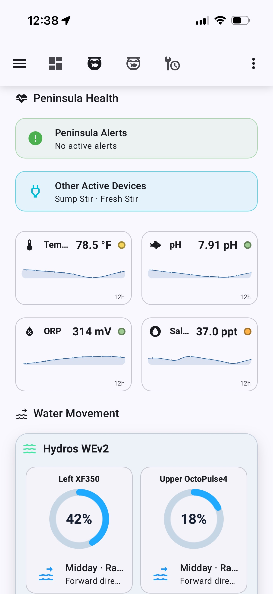
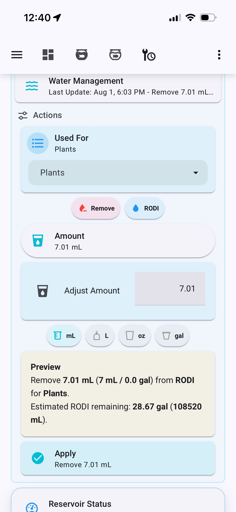
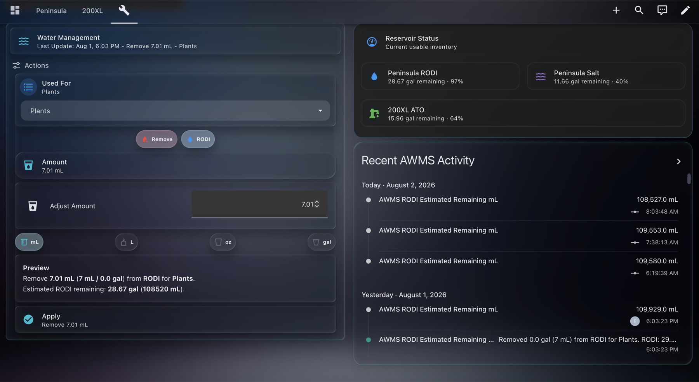
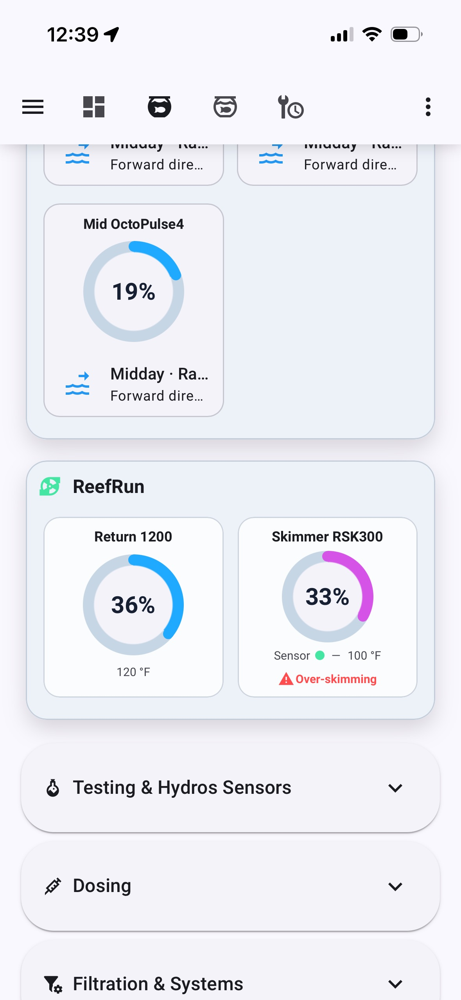
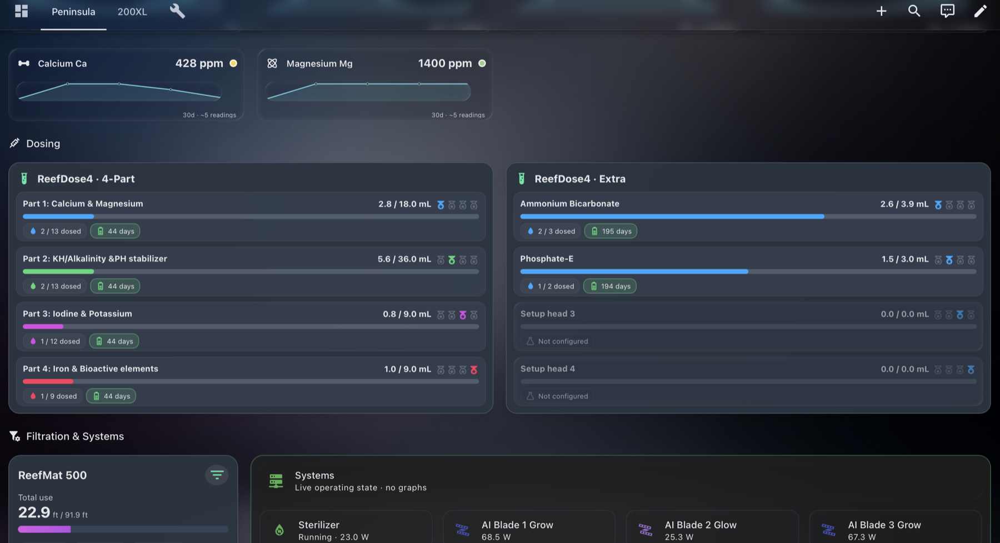

# Aquarium Automation Suite

Aquarium Automation Suite (AAS) is my Home Assistant dashboard and automation project for a Red Sea Peninsula reef aquarium and its HYDROS-controlled water-mixing station.

I have run Home Assistant since 2019. HYDROS and Red Sea each provide their own
view of the equipment they manage, but I wanted one place to understand the
display aquarium and the systems that support it. AAS brings those separate
ecosystems together and presents them around the jobs I actually perform.

The dashboard is the product. The automation underneath exists to make the system easier to understand and operate.

## My aquariums

### Red Sea Peninsula 500 G2

The Peninsula is a mixed reef and our primary display aquarium, located in the main living area of our townhouse.

| Platform | Equipment |
| --- | --- |
| Hydros | Kraken, X4, Launch, WaveEngine v2, X2, and XS |
| Red Sea | ReefRun return pump, RSK-300 skimmer, ReefMat 500, ReefDose4 - 4-Part, and ReefDose4-Extra |
| Other | UV sterilizer, Avast Marine feeder, and ozone |

The aquarium uses automatic top off and automatic water changes. The Hydros equipment at the nearby mixing station is part of the same collective.

The Hydros Simple Doser has been removed. Peninsula circulation is provided by
**Mid OctoPulse4**, **Upper OctoPulse4**, **Left XF350**, and a
**Sump OctoPulse 2**. The former Hydros Sump Stir output has been removed.

Both ReefDose controllers are organized in Home Assistant under the
**Aquarium** area:

- **ReefDose4 - 4-Part** doses Red Sea Complete 4-Part.
- **ReefDose4-Extra** is reserved for supplemental and occasional dosing.

Their entity families are `aquarium_reefdose4_4_part_*` and
`aquarium_reefdose4_extra_*`.

### Former Red Sea 200XL G2

The 200XL has been removed from the live AAS dashboards and is being handed off
with its own Home Assistant package. Its reusable files remain under
[`handoff/`]({{ site.github.repository_url }}/tree/main/handoff); legacy
screenshots and snippets are historical references rather than live AAS state.
Its former ReefDose now runs on the Peninsula as `ReefDose4-Extra`.

### Mixing station

The mixing station uses two nominal 30-gallon Brute reservoirs for RODI and saltwater. Hydros X2, XS, and XD controllers manage the station, and the XD drives three Kamoer dosing pumps used for ATO and AWC. These controllers share the Peninsula Hydros collective.

The station is useful beyond the aquariums—RODI water also goes to plants and other household jobs. That makes a separate inventory model valuable: the controller knows when a pump ran, but Home Assistant can describe where the water went and estimate what remains.

Two TP-Link smart power strips add more controllable outlets to the overall system.

## Two dashboard experiences

The Home Assistant interface provides:

- Peninsula views optimized separately for phone and tablet
- Water parameters and equipment status
- Auto / On / Off controls for selected HYDROS outputs, with live run status
- RODI and saltwater reservoir estimates
- Guided water-removal and transfer workflows
- Maintenance controls organized around real tasks
- A path toward activity history, usage statistics, and forecasting

The two dashboards share the same entities, templates, alert rules, and AWMS
workflow. **Aquarium Mobile** uses portrait-friendly two-column cards and
selective expanders. **Aquarium Tablet** uses the full landscape width for
wide tank summaries and equipment groups. Both use native Home
Assistant views for Overview, Peninsula, and Maintenance.

ReefBeat and HYDROS shortcuts remain available for setup and advanced
configuration. Home Assistant now also controls selected HYDROS output modes,
alongside the unified monitoring, alerting, trending, and guarded maintenance
surface.

| Aquarium Mobile | Aquarium Tablet |
| --- | --- |
|  | [View the current full-page Tablet capture](assets/screenshots/tablet/tablet-peninsula-current.png) |

[Explore Aquarium Mobile](mobile-dashboard.html) · [Explore Aquarium Tablet](tablet-dashboard.html)

### Water parameter presentation

The Peninsula view uses a compact, theme-aware parameter-card design. Each card
combines an icon, current value, status dot, operating-range
bands, and a history line. Mobile uses a two-column portrait grid; Tablet
spreads the same cards across full-width rows.

| Aquarium | Always visible | Testing & Hydros Sensors |
| --- | --- | --- |
| Peninsula | Display Temperature, pH, ORP, and salinity; 12-hour graphs with one point per hour | Salt Mix with a 12-hour graph; alkalinity, nitrate, phosphate, calcium, and magnesium with five samples across 30 days |

On Mobile, **Testing & Hydros Sensors** uses an expander to keep the initial
scan short. Tablet presents the same content in a wide row. The nested Mini Graph Card surface
is explicitly transparent, preserving the colored operating bands in the Home
Assistant mobile app.

The five weekly-test samples represent the current result and the previous four
test periods. Smoothing is disabled so each recorded interval stays visually
distinct. The cards use the labels **Alkalinity dKH**, **Nitrate NO₃**,
**Phosphate PO₄**, **Calcium Ca**, and **Magnesium Mg**.

### Controller and equipment presentation

The aquarium views use a ReefBeat-inspired visual language for
equipment while preserving the actual Hydros and Red Sea control boundaries.

- Peninsula flow is ordered **Left XF350**, **Upper OctoPulse4**, then
  **Mid OctoPulse4**, with the ReefRun return pump alongside the
  Hydros-controlled wave equipment. Mobile flow cards use tighter padding,
  four-pixel gaps, constrained grid cells, and 76px dial rings to avoid
  horizontal clipping.
- Each dosing head has a compact daily progress bar, completed-dose count,
  current/target volume, remaining-days indicator, and a four-head marker row.
- **ReefDose4 - 4-Part** and **ReefDose4-Extra** are stacked rather than placed
  side by side. The Extra controller uses blue progress bars; the 4-Part
  controller keeps distinct head colors.
- Remaining days are green at 15 days or more, yellow from 6–14 days, and red
  at 5 days or less.

The Mobile dashboard uses native Home Assistant views and selective expanders
for its longer sections. Tablet uses the same cards in wider rows with fewer
collapsed groups. Peninsula HYDROS circulation cards combine live output,
active schedule name, and direction.

Filtration & Systems → Other Devices includes the **TDS - Post DI** reading, and
Alerts calls out values above 0 ppm. Home Assistant currently exposes only
that first HYDROS TDS reading; the Pre DI reading is not yet available as an
entity.

The **Hydros Outputs** controls cover Water Feed, Fresh Stir, Feed Stir, AWC
ATO, AWC Drain, AWC Fill, Avast Feed, and Display Fans. Each control offers
**Auto**, **On**, and **Off**, and shows **Running**, the manually selected
mode, or **Auto · Idle**. Mobile keeps these controls in an expander; Tablet
shows them together in a cyan-bordered, full-width card that adapts from four
columns on wide screens to two or one on smaller screens. Drain and Fill use
the AWC start/stop helpers for their running status because the integration
does not publish separate running sensors for those phases. Both dashboards
also provide a full-width **HYDROS Mode** row with radio choices for EcoFlow,
Feeding, Low Power, Normal, and Water Change.

## Aquarium Water Management Suite

The first major AAS subsystem is the **Aquarium Water Management Suite (AWMS)**. It tracks the water shared by the aquariums, mixing station, and other uses.

The Water Management **Used For** control is a Mushroom Select card bound directly to `input_select.awms_workflow`, keeping its displayed selection synchronized with the preview and workflow-specific controls.

After **Apply**, a frontend-local Browser Mod sequence runs the adjustment and
then displays a four-second acknowledgement directly on the browser that
submitted it. This approach does not require that browser to be registered with
Browser Mod.

All inventory is stored internally in milliliters. Gallons are a display unit only.

```text
1 US gallon = 3,785.41 mL
```

| Reservoir | Working capacity | Notes |
| --- | ---: | --- |
| Peninsula RODI | 111,700 mL / 29.5 gal | Automatically filled under HYDROS control |
| Peninsula saltwater | 111,700 mL / 29.5 gal | Mixed from Peninsula RODI |

### Supported workflows

| Workflow | Source | Result |
| --- | --- | --- |
| Plants | RODI | Deducts Peninsula RODI |
| Make New Salt | RODI to saltwater | Deducts RODI and fills saltwater to capacity |
| Other | User-selected RODI or saltwater | Deducts the selected reservoir |





## Equipment monitoring

The same visual language is used for flow, dosing, filtration, and general equipment so that a large system remains easy to scan on a phone.

Water Parameter and Additional Water Parameter grids use a compact 4px gap.
On the Peninsula, **Return 1200** and **Skimmer RSK300** are grouped in a
two-column **ReefRun** card; ReefMat and the remaining systems stay under
Filtration & Systems. The return uses a blue ring and the skimmer uses a purple
ring. The skimmer box displays sensor-control status and conditionally shows a
red **Over-skimming** warning from
`sensor.aquarium_rsrun_peninsula_pump_2_state`. Hydros and ReefRun headings use
reduced spacing above their equipment boxes. The ReefRun pump temperature is
shown on the same compact line as the Skimmer sensor indicator.





## How it is built

AAS uses Home Assistant helpers, templates, automations, Script UI scripts, and a Lovelace dashboard. Helpers and the main AWMS script are intentionally created through the Home Assistant UI rather than declared as repository YAML.

Important inventory entities:

| Purpose | Entity |
| --- | --- |
| Peninsula RODI inventory | `input_number.awms_rodi_remaining_ml` |
| Peninsula saltwater inventory | `input_number.awms_salt_remaining_ml` |
| Adjustment amount | `input_number.awms_adjustment_amount` |
| Selected unit | `input_select.awms_adjustment_unit` |
| Selected action | `input_select.awms_adjustment_action` |
| Source reservoir | `input_select.awms_source_reservoir` |
| Workflow | `input_select.awms_workflow` |
| Apply adjustment | `script.awms_apply_adjustment` |

Repository examples:

| File | Purpose |
| --- | --- |
| [`mobile-dashboard.md`](mobile-dashboard.html) | Aquarium Mobile design and screenshot walkthrough |
| [`tablet-dashboard.md`](tablet-dashboard.html) | Aquarium Tablet design and screenshot walkthrough |
| [`aquarium-management skill`]({{ site.github.repository_url }}/tree/main/skills/aquarium-management) | Read-only Hermes v1 operating and diagnostic skill for the live Peninsula |
| [`awms-water-management-stack.yaml`]({{ site.github.repository_url }}/blob/main/snippets/awms-water-management-stack.yaml) | Main Water Management panel |
| [`awms-water-management-expander.yaml`]({{ site.github.repository_url }}/blob/main/snippets/awms-water-management-expander.yaml) | Collapsible Water Management panel |
| [`awms-reservoir-gauge-cards.yaml`]({{ site.github.repository_url }}/blob/main/snippets/awms-reservoir-gauge-cards.yaml) | Reservoir status gauges |
| [`awms-template-sensors.yaml`]({{ site.github.repository_url }}/blob/main/snippets/awms-template-sensors.yaml) | AWMS display and calculation sensors |
| [`awms-apply-adjustment-full-script.yaml`]({{ site.github.repository_url }}/blob/main/snippets/awms-apply-adjustment-full-script.yaml) | Script UI inventory logic |
| [`awms-sync-workflow-defaults-automation.yaml`]({{ site.github.repository_url }}/blob/main/snippets/awms-sync-workflow-defaults-automation.yaml) | Workflow-aware defaults |
| [`awms-recent-activity-card.yaml`]({{ site.github.repository_url }}/blob/main/snippets/awms-recent-activity-card.yaml) | Optional activity history |
| [`peninsula-water-parameters-chips.yaml`]({{ site.github.repository_url }}/blob/main/snippets/peninsula-water-parameters-chips.yaml) | Current Peninsula parameter and water-level stack |
| [`handoff/`]({{ site.github.repository_url }}/tree/main/handoff) | Decommissioned 200XL package for its receiving Home Assistant installation |
| [`peninsula-controller-equipment.yaml`]({{ site.github.repository_url }}/blob/main/snippets/peninsula-controller-equipment.yaml) | Peninsula equipment expanders |
| [`aquarium-controller-tabs-style.yaml`]({{ site.github.repository_url }}/blob/main/snippets/aquarium-controller-tabs-style.yaml) | Legacy theme-aware Simple Tabs styling retained for reference |

These are excerpts from a personal configuration, not a turnkey installation. Anyone adapting them should review entity names, capacities, limits, and safeguards for their own hardware.

## Interface components

The dashboard uses community frontend projects installed with [HACS](https://www.hacs.xyz/).

| Project | Role in AAS |
| --- | --- |
| [Mushroom](https://github.com/piitaya/lovelace-mushroom) | Cards, chips, and primary interaction patterns |
| [Button Card](https://github.com/custom-cards/button-card) | Theme-aware parameter-card shells, values, icons, and status indicators |
| [card-mod](https://github.com/thomasloven/lovelace-card-mod) | Styling and visual polish |
| [Expander Card](https://github.com/MelleD/lovelace-expander-card) | Collapsible maintenance and additional-parameter sections |
| [Gauge Card Pro](https://github.com/benjamin-dcs/gauge-card-pro) | Reservoir gauges |
| [Bubble Card](https://github.com/Clooos/Bubble-Card) | Section structure |
| [Mini Graph Card](https://github.com/kalkih/mini-graph-card) | Compact 12-hour and 30-day parameter history graphs |
| [Layout Card](https://github.com/thomasloven/lovelace-layout-card) | Responsive two-column parameter layouts inside nested tabs and expanders |
| [Vertical Stack In Card](https://github.com/ofekashery/vertical-stack-in-card) | Grouped layouts |

RODI is consistently blue and saltwater is purple. Existing Gauge Card Pro reservoir cards are treated as production components and enhanced rather than redesigned.

## Integration credits

Special thanks to the developers whose community integrations make the unified dashboard possible:

- **Elwinmage** created and maintains the [Red Sea ReefBeat integration](https://github.com/Elwinmage/ha-reefbeat-component), which brings supported Red Sea equipment into Home Assistant.
- **Bitf1ip** created and maintains the [HYDROS integration](https://github.com/Bitf1ip/ha-hydros), which brings CoralVue HYDROS controller data into Home Assistant.

Their work supplies the aquarium entities on which AAS depends. Thank you also to the teams and contributors behind [Home Assistant](https://www.home-assistant.io/), [HACS](https://www.hacs.xyz/), and the dashboard projects listed above.

This project has been designed collaboratively with ChatGPT over multiple design and implementation sessions.

## Roadmap

- **Version 1:** inventory, dashboard, manual adjustments, and transfers
- **Version 1.1:** activity log, statistics, and automatic Hydros refill handling
- **Version 1.2:** Peninsula ATO/AWC usage analytics
- **Version 2:** forecasting, maintenance planning, consumables, and predictive reservoir depletion

Reliability, readability, maintainability, and a consistent interface take priority over adding features quickly.

## Disclaimer

AAS is an independent personal project and is not affiliated with or endorsed by Red Sea, CoralVue, TP-Link, the integration authors, or Home Assistant. Aquarium automation can move water and control life-support equipment. Validate every entity, limit, fail-safe, and physical safeguard before adapting an example to another system.

[View the repository]({{ site.github.repository_url }})
