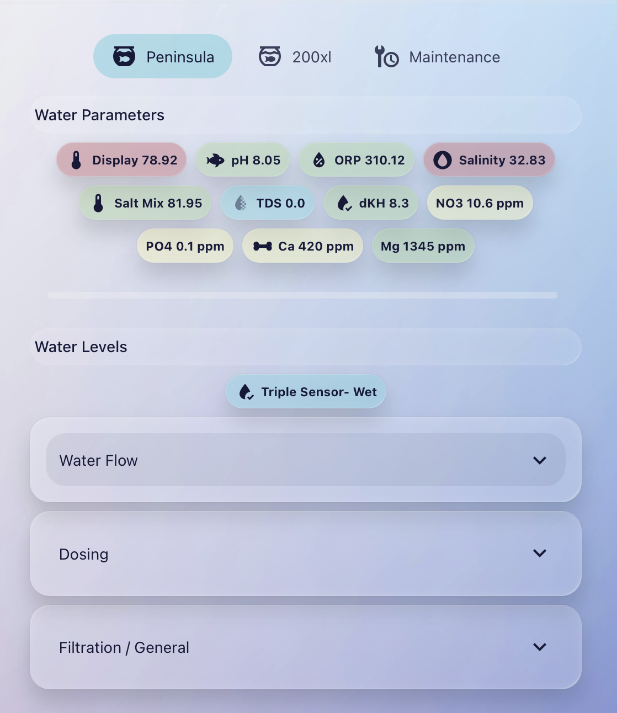
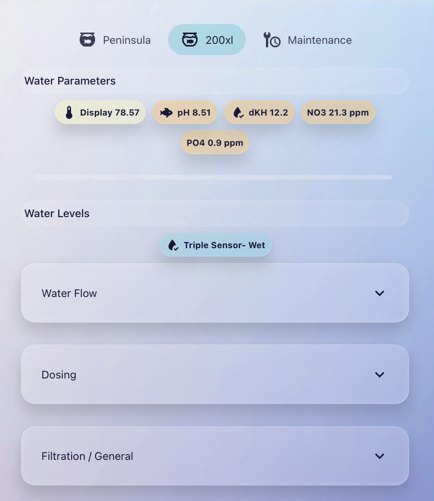
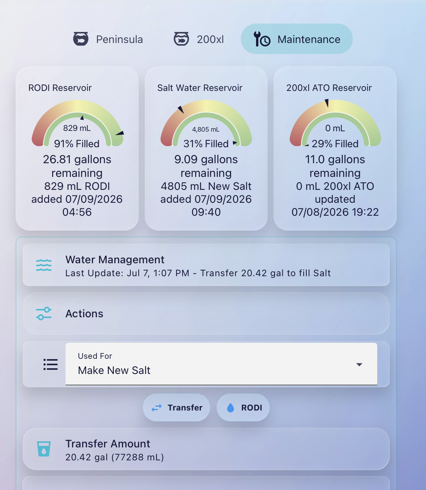
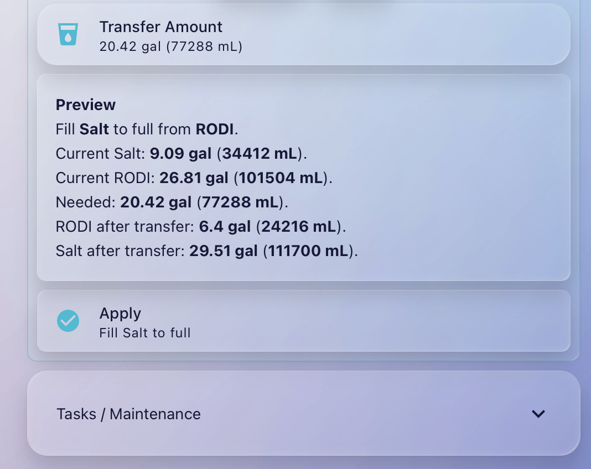
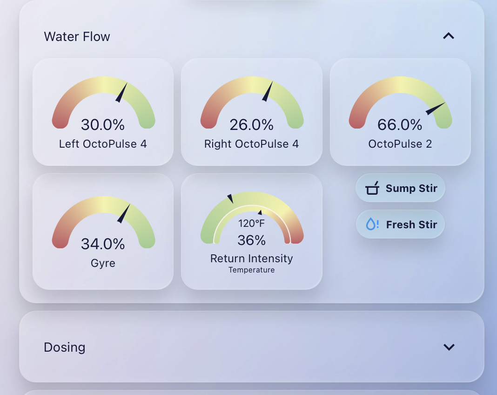
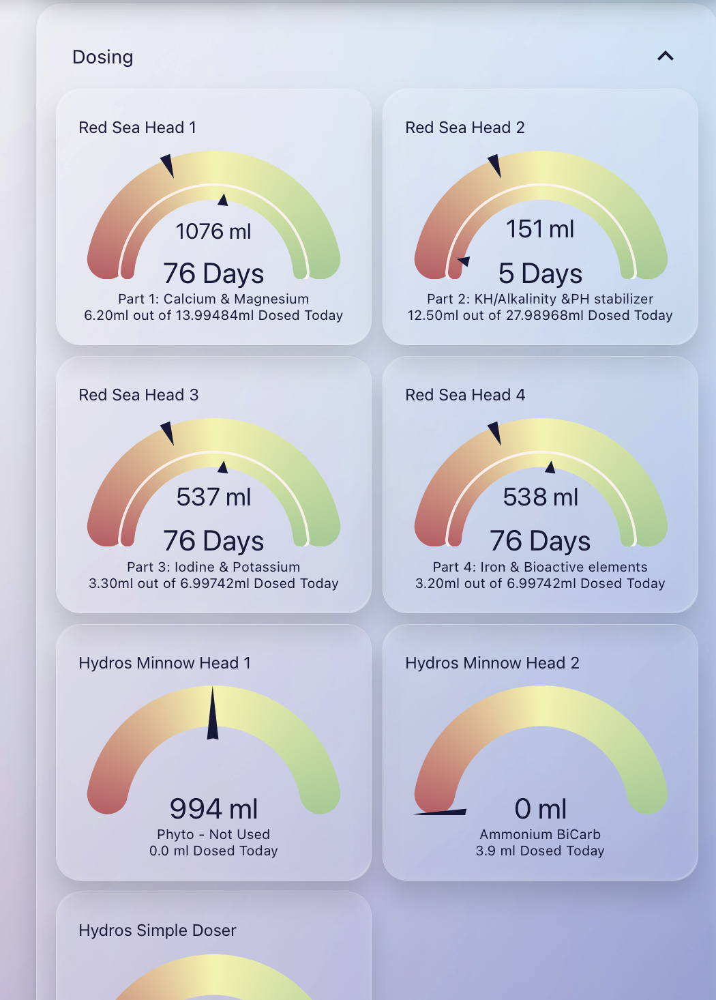
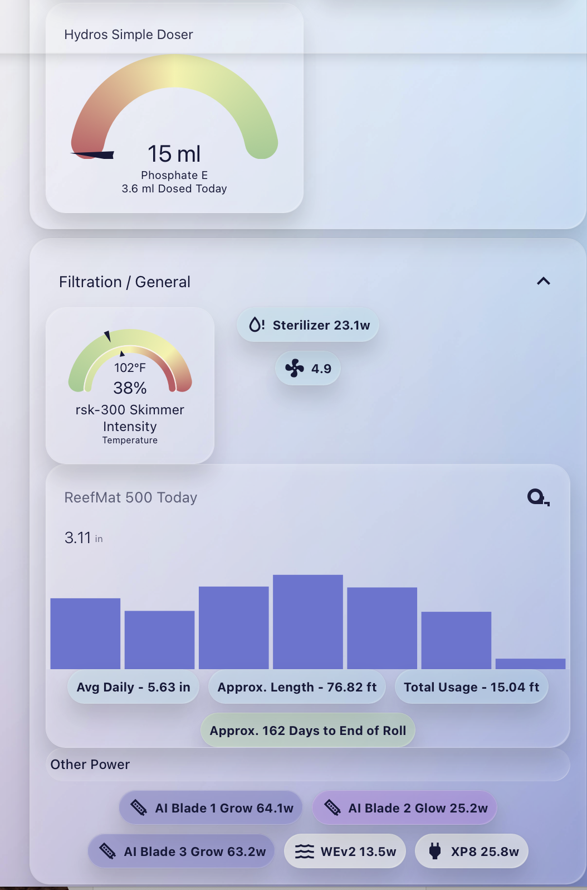

# Aquarium Automation Suite

Aquarium Automation Suite (AAS) is my Home Assistant dashboard and automation project for two Red Sea aquariums and their shared water-mixing station.

I have run Home Assistant since 2019. Hydros and Red Sea each provide their own view of the equipment they manage, but I wanted one place where I could see both aquariums and the systems that support them. AAS brings those separate ecosystems together and presents them around the jobs I actually perform.

The dashboard is the product. The automation underneath exists to make the system easier to understand and operate.

## My aquariums

### Red Sea Peninsula 500 G2

The Peninsula is a mixed reef and our primary display aquarium, located in the main living area of our townhouse.

| Platform | Equipment |
| --- | --- |
| Hydros | Kraken, X4, Launch, WaveEngine v2, X2, and XS |
| Red Sea | ReefRun return pump, RSK-300 skimmer, ReefMat 500, ReefDose4 - 4-Part, and ReefDose4-Extra |
| Other | UV sterilizer, Avast Marine feeder, and ozone |

The aquarium uses automatic top off and automatic water changes. The Hydros equipment at the nearby mixing station is part of the same collective.

The Hydros Simple Doser and Peninsula OctoPulse 2 have been removed. Current
Peninsula circulation is provided by **Mid OctoPulse4**, **Upper OctoPulse4**,
and **Left XF350**.

Both ReefDose controllers are organized in Home Assistant under the
**Aquarium** area:

- **ReefDose4 - 4-Part** doses Red Sea Complete 4-Part.
- **ReefDose4-Extra** is reserved for supplemental and occasional dosing.

Their entity families are `aquarium_reefdose4_4_part_*` and
`aquarium_reefdose4_extra_*`.

### Red Sea 200XL G2

The 200XL is a soft coral and anemone aquarium with a couple of clownfish and chromis.

| Platform | Equipment |
| --- | --- |
| Hydros | Launch, WaveEngine LE, WiFi Quad, WiFi Feeder, and Minnow |
| Red Sea | None currently connected |

The 200XL is an independent aquarium with its own ATO reservoir and manual water changes. Its ATO reservoir is filled manually from the Peninsula RODI supply.

Its former ReefDose 4 now runs on the Peninsula as `ReefDose4-Extra`.

The Hydros Minnow is now installed on the 200XL. Its first head is represented
by the `bedroom_aquarium_minnow_head_1*` entities and appears in the 200XL
Dosing expander. The second physical head is unused and does not currently
have a Hydros entity, so it is shown as not configured. Home Assistant assigns
the exposed entities to the **Bedroom** area, although Hydros currently still
publishes them under the integration-owned **Aquarium Hydros** parent device.
The parent association will change only after the output belongs to the Bedroom
Aquarium collective in Hydros and the integration is reloaded.

### Mixing station

The mixing station uses two nominal 30-gallon Brute reservoirs for RODI and saltwater. Hydros X2, XS, and XD controllers manage the station, and the XD drives three Kamoer dosing pumps used for ATO and AWC. These controllers share the Peninsula Hydros collective.

The station is useful beyond the aquariums—RODI water also goes to plants and other household jobs. That makes a separate inventory model valuable: the controller knows when a pump ran, but Home Assistant can describe where the water went and estimate what remains.

Two TP-Link smart power strips add more controllable outlets to the overall system.

## One dashboard

The Home Assistant interface provides:

- A combined view of both aquariums
- Water parameters and equipment status
- RODI, saltwater, and 200XL ATO reservoir estimates
- Guided water-removal and transfer workflows
- Maintenance controls organized around real tasks
- A path toward activity history, usage statistics, and forecasting





### Water parameter presentation

The Peninsula and 200XL tabs use the same compact, theme-aware parameter-card
design. Each card combines an icon, current value, status dot, operating-range
bands, and a history line. Layout Card presents the group in two columns above
767 pixels and falls back to one column on phones and other narrow displays.

| Aquarium | Always visible | Additional Water Parameters |
| --- | --- | --- |
| Peninsula | Display Temperature, pH, ORP, and salinity; 12-hour graphs with one point per hour | Salt Mix with a 12-hour graph; alkalinity, nitrate, phosphate, calcium, and magnesium with five samples across 30 days; compact TDS value |
| 200XL | Display Temperature and pH; 12-hour graphs with one point per hour | Alkalinity, nitrate, and phosphate with five samples across 30 days |

The collapsed **Additional Water Parameters** expander sits below Water Levels
on both tabs. Its contents use the same responsive two-column layout as the
primary cards. The 200XL does not currently expose ORP or salinity entities, so
those parameters are not represented there. The nested Mini Graph Card surface
is explicitly transparent, preserving the colored operating bands in the Home
Assistant mobile app.

The five weekly-test samples represent the current result and the previous four
test periods. Smoothing is disabled so each recorded interval stays visually
distinct. The cards use the labels **Alkalinity dKH**, **Nitrate NO₃**,
**Phosphate PO₄**, **Calcium Ca**, and **Magnesium Mg**.

### Controller and equipment presentation

The production Controllers view uses a ReefBeat-inspired visual language for
equipment while preserving the actual Hydros and Red Sea control boundaries.

- Peninsula flow is ordered **Left XF350**, **Upper OctoPulse4**, then
  **Mid OctoPulse4**, with the ReefRun return pump alongside the
  Hydros-controlled wave equipment. Mobile flow cards use tighter padding,
  four-pixel gaps, constrained grid cells, and 76px dial rings to avoid
  horizontal clipping.
- Each dosing head has a compact daily progress bar, completed-dose count,
  current/target volume, remaining-days indicator, and a four-head marker row.
- **ReefDose4 - 4-Part** and **ReefDose4-Extra** are stacked rather than placed
  side by side. The Extra controller uses blue progress bars; the 4-Part
  controller keeps distinct head colors.
- Remaining days are green at 15 days or more, yellow from 6–14 days, and red
  at 5 days or less.
- The 200XL Minnow shows unused outputs as not configured until Hydros exposes
  an entity for them.

The Peninsula, 200XL, and Maintenance buttons use theme-aware Simple Tabs
colors. Active text, inactive text, hover accents, borders, and the selected
background follow Home Assistant theme variables for light and dark modes. A
**Controllers · Classic** view remains available as the pre-redesign backup.

## Aquarium Water Management Suite

The first major AAS subsystem is the **Aquarium Water Management Suite (AWMS)**. It tracks the water shared by the aquariums, mixing station, and other uses.

The Water Management **Used For** control is a Mushroom Select card bound directly to `input_select.awms_workflow`, keeping its displayed selection synchronized with the preview and workflow-specific controls.

After **Apply**, a frontend-local Browser Mod sequence runs the adjustment and
then displays a four-second acknowledgement directly on the browser that
submitted it. This approach does not require that browser to be registered with
Browser Mod.

All inventory is stored internally in milliliters. Gallons are a display unit only.

```text
1 US gallon = 3,785.41 mL
```

| Reservoir | Working capacity | Notes |
| --- | ---: | --- |
| Peninsula RODI | 111,700 mL / 29.5 gal | Automatically filled under Hydros control |
| Peninsula saltwater | 111,700 mL / 29.5 gal | Mixed from Peninsula RODI |
| 200XL ATO | 75,708 mL / about 20 gal | Filled from Peninsula RODI; physical capacity is about 30 gal |

When the 200XL ATO reservoir is filled through AWMS, the same volume is deducted from Peninsula RODI and added to the 200XL ATO estimate. The normal AWMS maximum is about 20 gallons even though the container can physically hold about 30 gallons.

### Supported workflows

| Workflow | Source | Result |
| --- | --- | --- |
| Plants | RODI | Deducts Peninsula RODI |
| Make New Salt | RODI to saltwater | Deducts RODI and fills saltwater to capacity |
| 200XL ATO | RODI to 200XL ATO | Deducts RODI and increases the 200XL ATO estimate |
| 200XL Water Change | Saltwater | Deducts Peninsula saltwater |
| Other | User-selected RODI or saltwater | Deducts the selected reservoir |





## Equipment views

The same visual language is used for flow, dosing, filtration, and general equipment so that a large system remains easy to scan on a phone.

Water Parameter and Additional Water Parameter grids use a compact 4px gap.
On the Peninsula, **Return 1200** and **Skimmer RSK300** are grouped in a
two-column **ReefRun** card; ReefMat and the remaining systems stay under
Filtration / General. The return uses a blue ring and the skimmer uses a purple
ring. The skimmer box displays sensor-control status and conditionally shows a
red **Over-skimming** warning from
`sensor.aquarium_rsrun_peninsula_pump_2_state`. Hydros and ReefRun headings use
reduced spacing above their equipment boxes. The ReefRun pump temperature is
shown on the same compact line as the Skimmer sensor indicator.







## How it is built

AAS uses Home Assistant helpers, templates, automations, Script UI scripts, and a Lovelace dashboard. Helpers and the main AWMS script are intentionally created through the Home Assistant UI rather than declared as repository YAML.

Important inventory entities:

| Purpose | Entity |
| --- | --- |
| Peninsula RODI inventory | `input_number.awms_rodi_remaining_ml` |
| Peninsula saltwater inventory | `input_number.awms_salt_remaining_ml` |
| 200XL ATO inventory | `input_number.awms_200xl_ato_remaining_ml` |
| Adjustment amount | `input_number.awms_adjustment_amount` |
| Selected unit | `input_select.awms_adjustment_unit` |
| Selected action | `input_select.awms_adjustment_action` |
| Source reservoir | `input_select.awms_source_reservoir` |
| Workflow | `input_select.awms_workflow` |
| Apply adjustment | `script.awms_apply_adjustment` |

Repository examples:

| File | Purpose |
| --- | --- |
| [`awms-water-management-stack.yaml`]({{ site.github.repository_url }}/blob/main/snippets/awms-water-management-stack.yaml) | Main Water Management panel |
| [`awms-water-management-expander.yaml`]({{ site.github.repository_url }}/blob/main/snippets/awms-water-management-expander.yaml) | Collapsible Water Management panel |
| [`awms-reservoir-gauge-cards.yaml`]({{ site.github.repository_url }}/blob/main/snippets/awms-reservoir-gauge-cards.yaml) | Reservoir status gauges |
| [`awms-template-sensors.yaml`]({{ site.github.repository_url }}/blob/main/snippets/awms-template-sensors.yaml) | AWMS display and calculation sensors |
| [`awms-apply-adjustment-full-script.yaml`]({{ site.github.repository_url }}/blob/main/snippets/awms-apply-adjustment-full-script.yaml) | Script UI inventory logic |
| [`awms-sync-workflow-defaults-automation.yaml`]({{ site.github.repository_url }}/blob/main/snippets/awms-sync-workflow-defaults-automation.yaml) | Workflow-aware defaults |
| [`awms-recent-activity-card.yaml`]({{ site.github.repository_url }}/blob/main/snippets/awms-recent-activity-card.yaml) | Optional activity history |
| [`peninsula-water-parameters-chips.yaml`]({{ site.github.repository_url }}/blob/main/snippets/peninsula-water-parameters-chips.yaml) | Current Peninsula parameter and water-level stack |
| [`200xl-water-parameters-chips.yaml`]({{ site.github.repository_url }}/blob/main/snippets/200xl-water-parameters-chips.yaml) | Current 200XL parameter and water-level stack |
| [`peninsula-controller-equipment.yaml`]({{ site.github.repository_url }}/blob/main/snippets/peninsula-controller-equipment.yaml) | Peninsula equipment expanders |
| [`200xl-controller-equipment.yaml`]({{ site.github.repository_url }}/blob/main/snippets/200xl-controller-equipment.yaml) | 200XL equipment expanders |
| [`aquarium-controller-tabs-style.yaml`]({{ site.github.repository_url }}/blob/main/snippets/aquarium-controller-tabs-style.yaml) | Theme-aware Simple Tabs styling |

These are excerpts from a personal configuration, not a turnkey installation. Anyone adapting them should review entity names, capacities, limits, and safeguards for their own hardware.

## Interface components

The dashboard uses community frontend projects installed with [HACS](https://www.hacs.xyz/).

| Project | Role in AAS |
| --- | --- |
| [Mushroom](https://github.com/piitaya/lovelace-mushroom) | Cards, chips, and primary interaction patterns |
| [Button Card](https://github.com/custom-cards/button-card) | Theme-aware parameter-card shells, values, icons, and status indicators |
| [card-mod](https://github.com/thomasloven/lovelace-card-mod) | Styling and visual polish |
| [Expander Card](https://github.com/MelleD/lovelace-expander-card) | Collapsible maintenance and additional-parameter sections |
| [Gauge Card Pro](https://github.com/benjamin-dcs/gauge-card-pro) | Reservoir gauges |
| [Bubble Card](https://github.com/Clooos/Bubble-Card) | Section structure |
| [Mini Graph Card](https://github.com/kalkih/mini-graph-card) | Compact 12-hour and 30-day parameter history graphs |
| [Layout Card](https://github.com/thomasloven/lovelace-layout-card) | Responsive two-column parameter layouts inside nested tabs and expanders |
| [Simple Tabs](https://github.com/agoberg85/home-assistant-simple-tabs) | Aquarium dashboard tabs |
| [Vertical Stack In Card](https://github.com/ofekashery/vertical-stack-in-card) | Grouped layouts |

RODI is consistently blue, saltwater is purple, and 200XL ATO is green. Existing Gauge Card Pro reservoir cards are treated as production components and enhanced rather than redesigned.

## Integration credits

Special thanks to the developers whose community integrations make the unified dashboard possible:

- **Elwinmage** created and maintains the [Red Sea ReefBeat integration](https://github.com/Elwinmage/ha-reefbeat-component), which brings supported Red Sea equipment into Home Assistant.
- **Bitf1ip** created and maintains the [HYDROS integration](https://github.com/Bitf1ip/ha-hydros), which brings CoralVue HYDROS controller data into Home Assistant.

Their work supplies the aquarium entities on which AAS depends. Thank you also to the teams and contributors behind [Home Assistant](https://www.home-assistant.io/), [HACS](https://www.hacs.xyz/), and the dashboard projects listed above.

This project has been designed collaboratively with ChatGPT over multiple design and implementation sessions.

## Roadmap

- **Version 1:** inventory, dashboard, manual adjustments, and transfers
- **Version 1.1:** activity log, statistics, and automatic Hydros refill handling
- **Version 1.2:** 200XL ATO runtime tracking and usage analytics
- **Version 2:** forecasting, maintenance planning, consumables, and predictive reservoir depletion

Reliability, readability, maintainability, and a consistent interface take priority over adding features quickly.

## Disclaimer

AAS is an independent personal project and is not affiliated with or endorsed by Red Sea, CoralVue, TP-Link, the integration authors, or Home Assistant. Aquarium automation can move water and control life-support equipment. Validate every entity, limit, fail-safe, and physical safeguard before adapting an example to another system.

[View the repository]({{ site.github.repository_url }})
