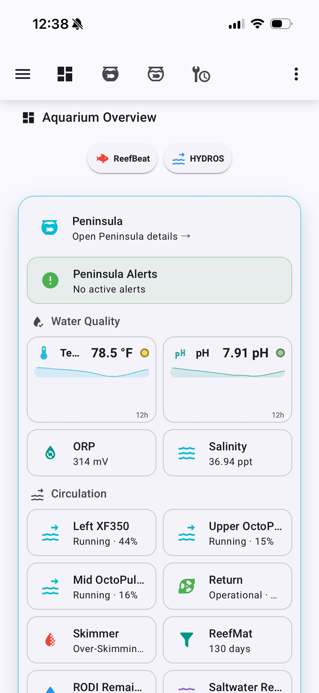
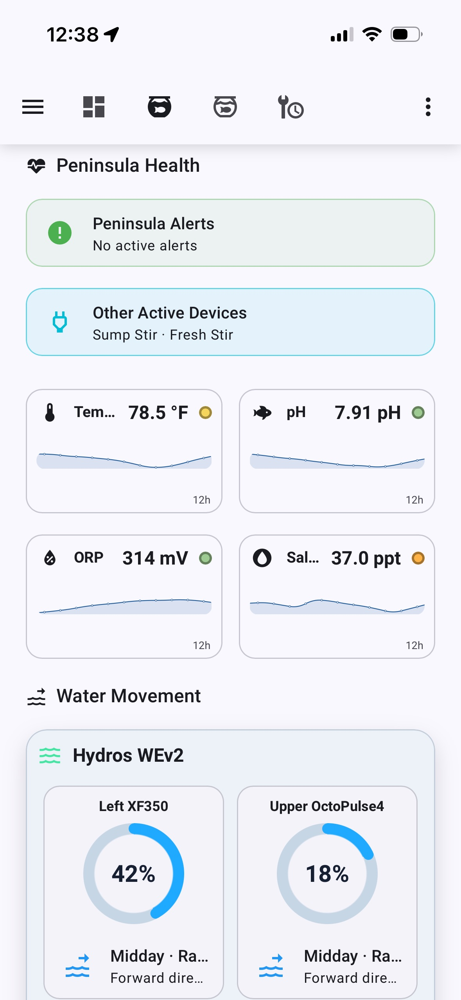
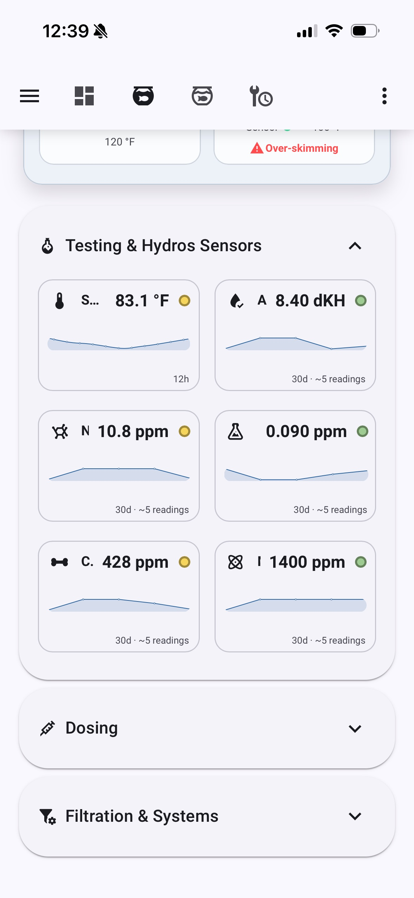
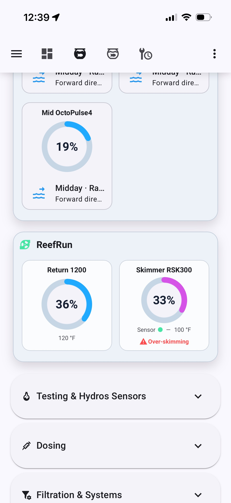
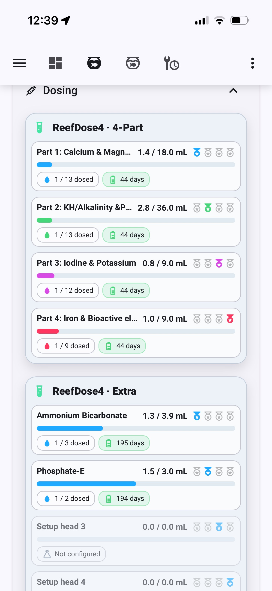
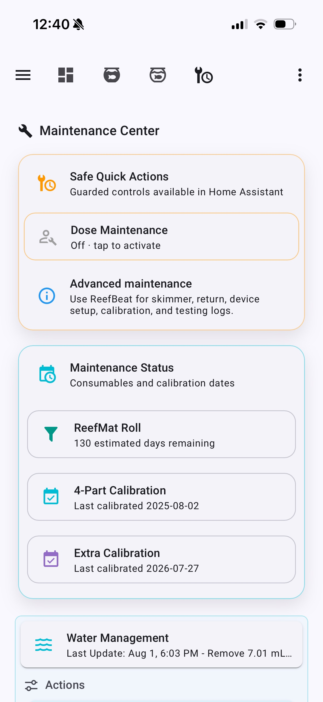
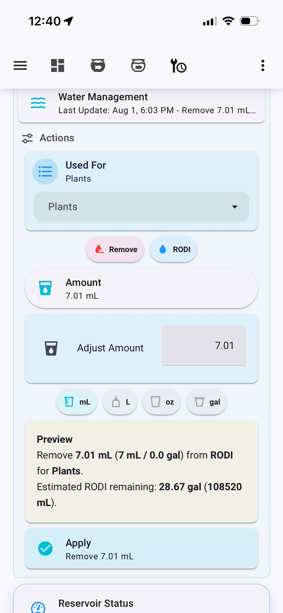
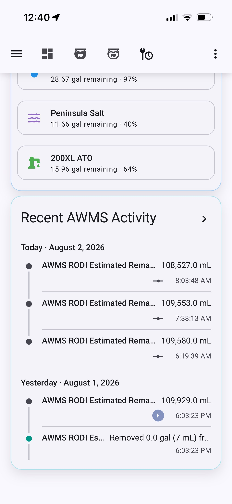

# Aquarium Mobile dashboard

**Aquarium Mobile** is the everyday phone interface for AAS. It uses native Home Assistant views for **Overview**, **Peninsula**, and **Maintenance**, keeping navigation available in the Companion app without nesting the whole dashboard inside a custom tab card.

The interface is monitoring-first, with Home Assistant controls for selected HYDROS outputs alongside status, alerts, trends, guarded maintenance actions, and the Aquarium Water Management Suite (AWMS) workflow. ReefBeat and HYDROS remain useful for device setup and advanced configuration.

## Overview

The Overview view answers the quickest questions first: are there alerts, are the core water parameters in range, are circulation and life-support devices running, and how much water remains? The live dashboards focus on the Peninsula.

The alert card changes from green to red when a condition needs attention. Normal optical-sensor states stay out of the way; exceptional states such as a high sump, dry RODI-low sensor, nonzero TDS, or an unexpected dry ATO sensor surface through Alerts.

The Peninsula view places a compact Tank Health ring immediately above the
Alerts card. It uses the same circular treatment as the Water Movement pump
dials, changes color across Critical, Attention, Watch, Healthy, and Excellent
ranges, and keeps Primary Read, Nutrient Balance, and Data Confidence inside
the same box without repeating the Core Parameters cards.

## Aquarium views

The Peninsula view starts with **Alerts** and **Other Active Devices**. Other Active Devices is reserved for equipment that is expected to cycle—stir pumps, fans, ozone, AWC phases, and similar loads—rather than devices that normally run continuously.

Water-quality cards use compact 12-hour history lines and a colored status dot. Manually entered chemistry tests use a 30-day window representing roughly five readings.

Water movement uses ReefBeat-inspired rings for both Red Sea and HYDROS equipment. HYDROS wave-pump cards add the current schedule name and direction beneath the live percentage.

The **Hydros Outputs** expander provides **Auto**, **On**, and **Off** controls for Water Feed, Fresh Stir, Feed Stir, AWC ATO, AWC Drain, AWC Fill, Avast Feed, and Display Fans. Each output is grouped with its controls, uses teal accents, and displays its current running or selected mode. The Tablet dashboard keeps the same controls open in a full-width, responsive card.

The longer **Testing & Hydros Sensors**, **Dosing**, and **Filtration & Systems** groups use expanders on mobile. This keeps the initial scan compact without hiding the detail when it is needed.

## Maintenance

Maintenance combines a guarded **Dose Maintenance** quick action, consumable and calibration status, AWMS water adjustments, reservoir estimates, and recent inventory activity. Advanced ReefBeat configuration and testing logs remain in ReefBeat.

## Design choices

- Native Home Assistant views provide reliable mobile navigation.
- Two-column cards balance information density with portrait readability.
- Expanders are used selectively for long detail sections, not for primary health and flow information.
- Alerts show exceptions; normal sensor states do not consume space.
- ReefBeat and HYDROS remain the control surfaces for device setup and advanced configuration; selected HYDROS output modes are available directly in Home Assistant.
- The same entities, templates, and alert rules feed both Mobile and Tablet.

[Return to the project overview](index.html) · [View the Tablet dashboard](tablet-dashboard.html)
