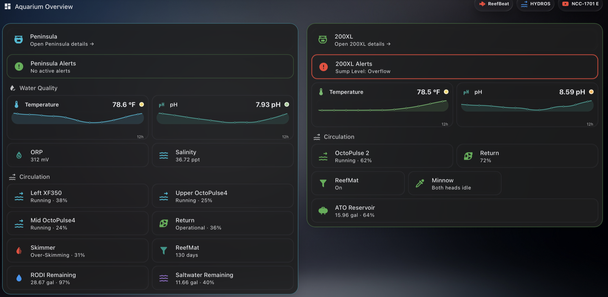
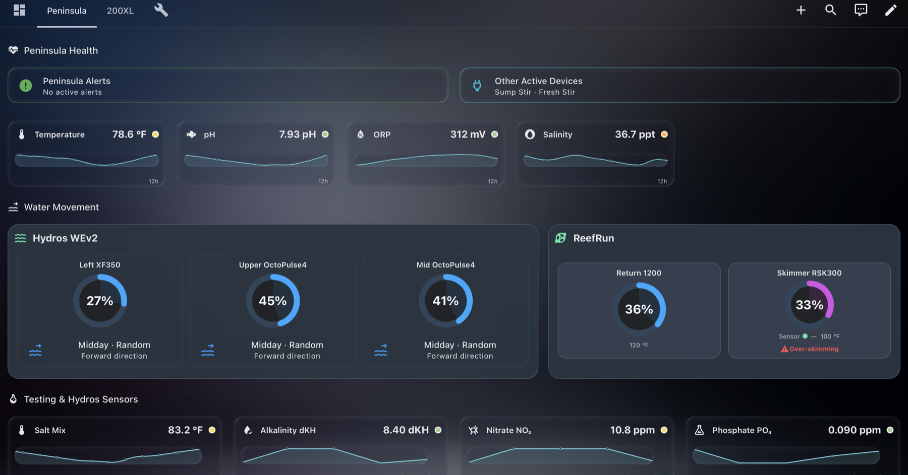
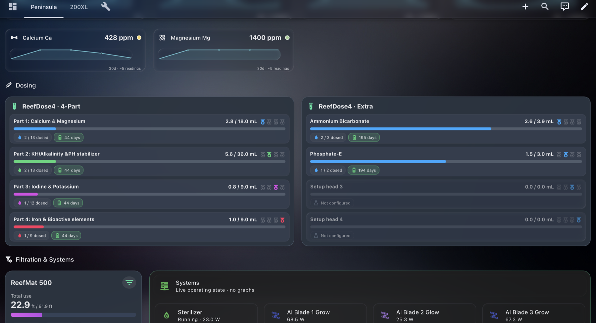
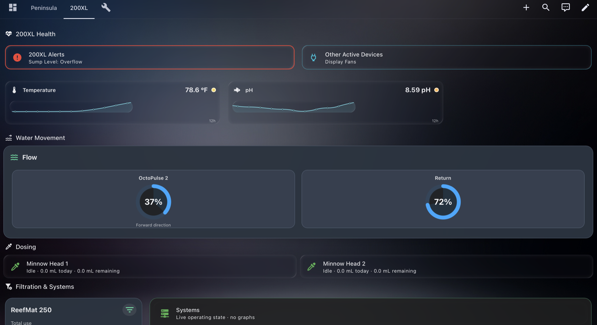
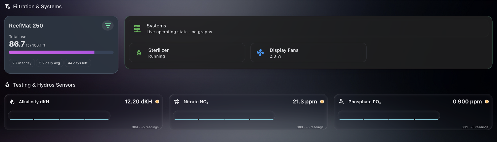
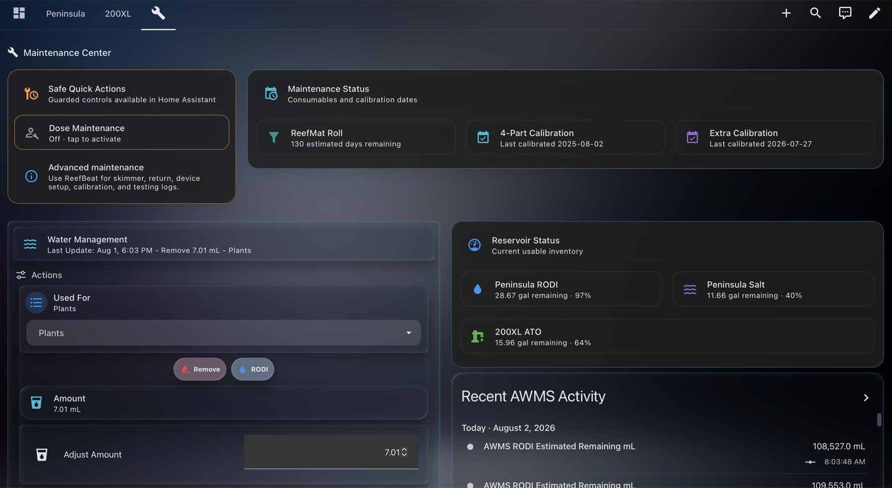
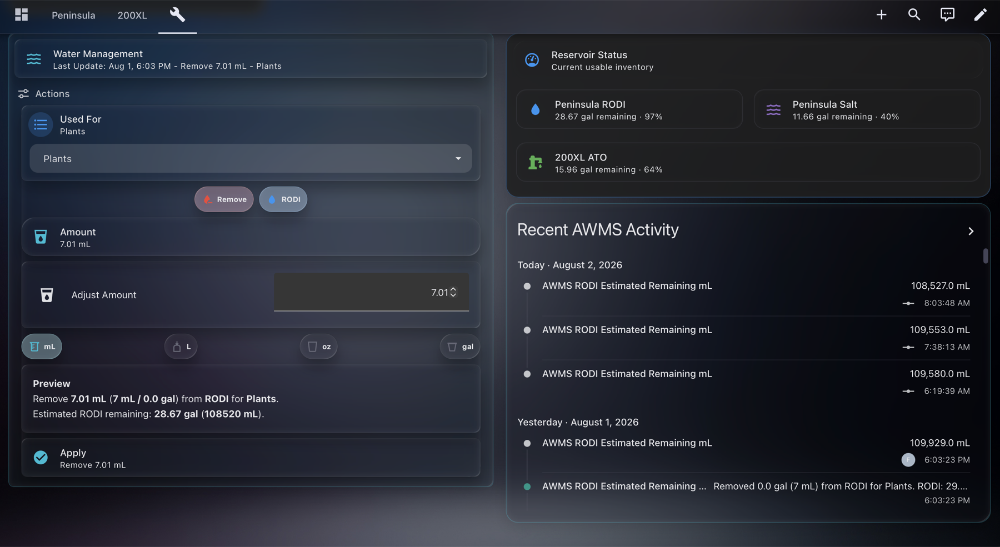

# Aquarium Tablet dashboard

**Aquarium Tablet** is the landscape, full-width AAS interface intended for the iPad Pro beside the Peninsula. It shares the same entities, templates, alerts, and maintenance workflows as Aquarium Mobile, but uses the available width to reduce scrolling and keep related equipment visible together.

## Overview

Peninsula and 200XL summaries sit side by side. Each panel is also a navigation target for its detailed aquarium view. The overview emphasizes current health, exceptions, core water quality, circulation, filtration, and reservoir inventory.

## Peninsula

The Peninsula view places Alerts and Other Active Devices on one row, four water-quality graphs on the next, and the HYDROS WaveEngine and ReefRun groups together. Testing uses four cards across; the two ReefDose controllers can share a row.

## 200XL

The 200XL view follows the same hierarchy with fewer devices: exception-based alerts, active devices, temperature and pH, flow, Minnow monitoring, ReefMat, systems, and chemistry testing.

## Maintenance

The landscape maintenance view puts quick actions and maintenance status above a two-column working area. AWMS actions remain on the left while reservoir status and recent activity remain visible on the right, making the preview and inventory effect easy to compare before Apply is pressed.

## Design choices

- Full-width layout is optimized for landscape iPad use.
- Related systems share rows instead of becoming one long vertical stack.
- Primary information remains visible without expanders where space permits.
- Wider cards preserve complete labels, graphs, schedule names, and equipment state.
- The visual hierarchy and color rules match Aquarium Mobile.

[Return to the project overview](index.html) · [View the Mobile dashboard](mobile-dashboard.html)
